# Praktikum Minggu 03

## MODUL 3 — SINKRONISASI PADA SISTEM TERDISTRIBUSI

### 1. Tujuan Pembelajaran

Praktikum Modul 3 bertujuan untuk:

1. Memahami proses sinkronisasi waktu menggunakan protokol NTP.
2. Memahami penggunaan Vector Clock untuk mengetahui urutan kejadian (event) dalam sistem terdistribusi.
3. Mengamati perbedaan urutan keluaran program yang menggunakan multithreading.
4. Memahami penyebab terjadinya data race atau race condition serta cara mencegahnya.
5. Memahami penyebab deadlock dan mengamati program yang dirancang untuk menghindarinya.
6. Memahami cara kerja dasar algoritma Raft dalam pemilihan koordinator atau leader.
7. Membuat modul Python dan menjalankan contoh penggunaannya sesuai tugas yang tercantum dalam modul.

### 2. Dasar Teori

#### 2.1 Sinkronisasi Waktu

Sinkronisasi waktu merupakan proses menyelaraskan waktu pada komputer dengan sumber waktu acuan. Dalam sistem terdistribusi, waktu dibutuhkan untuk membantu pencatatan kejadian dan koordinasi antarkomputer. Modul menjelaskan dua protokol sinkronisasi waktu, yaitu NTP (Network Time Protocol) dan PTP (Precision Time Protocol). Pada sistem operasi Windows, praktikum ini menggunakan aplikasi NetTime untuk melakukan sinkronisasi dengan server NTP.

#### 2.2 Vector Clock

Vector Clock merupakan metode untuk mencatat urutan logis kejadian pada sistem terdistribusi. Setiap proses memiliki vektor penghitung yang nilainya diperbarui ketika proses menjalankan kejadian, mengirim pesan, atau menerima pesan. Saat pesan diterima, proses menggabungkan nilai vektor lokal dengan vektor dari pesan menggunakan nilai terbesar pada setiap komponen, kemudian menaikkan penghitung milik proses penerima. Vector Clock membantu menentukan apakah suatu kejadian terjadi sebelum kejadian lain atau apakah kedua kejadian tidak memiliki hubungan kausal langsung.

#### 2.3 Multithreading

Multithreading adalah teknik menjalankan beberapa thread dalam satu program. Setiap thread dapat memperoleh giliran eksekusi yang berbeda sehingga urutan pesan yang tampil di terminal tidak selalu sama pada setiap percobaan. Hal ini terjadi karena pelaksanaan thread dipengaruhi oleh penjadwalan sistem operasi dan waktu yang dibutuhkan setiap thread untuk menyelesaikan tugasnya.

#### 2.4 Data Race dan Race Condition

Race condition merupakan keadaan ketika hasil program dipengaruhi oleh urutan atau waktu akses beberapa thread terhadap data yang sama. Jika beberapa thread membaca dan mengubah data bersama tanpa perlindungan, keduanya dapat menggunakan nilai lama yang sama dan menghasilkan perubahan data yang tidak sesuai harapan. Pada Python, salah satu cara melindungi bagian program yang mengakses data bersama adalah menggunakan threading.Lock.

#### 2.5 Deadlock

Deadlock merupakan keadaan ketika dua atau lebih thread saling menunggu sumber daya yang sedang dikunci oleh thread lain sehingga proses tidak dapat melanjutkan. Contohnya, Thread 1 memegang Lock A dan menunggu Lock B, sedangkan Thread 2 memegang Lock B dan menunggu Lock A. Kondisi saling menunggu tersebut dapat membuat program berhenti tanpa menyelesaikan pekerjaannya.

#### 2.6 Algoritma Raft

Raft merupakan algoritma konsensus yang digunakan dalam sistem terdistribusi. Salah satu mekanismenya adalah pemilihan leader untuk mengoordinasikan aktivitas kelompok node. Secara sederhana, node dapat menjadi kandidat, mengajukan pemilihan, lalu menjadi leader apabila memperoleh suara mayoritas. Source code pada praktikum merupakan simulasi yang disederhanakan untuk membantu memahami konsep pemilihan leader, bukan implementasi lengkap seluruh protokol Raft.

### 3. Alat dan Bahan

1. Laptop atau komputer.
2. Koneksi internet untuk mengunduh NetTime dan melakukan sinkronisasi waktu.
3. Python 3 yang telah terpasang.
4. Source code praktikum dari dosen, yaitu:
   - vclocks.py
   - multithreads-example.py atau nama file multithreading yang tersedia pada paket source
   - race-conditions-01.py
   - race-conditions-02.py
   - deadlock-01.py
   - deadlock-02.py
   - raft.py
5. Command Prompt (CMD) atau terminal Visual Studio Code.
6. Editor kode, seperti Visual Studio Code.
7. Aplikasi NetTime.
8. Kertas dan alat tulis untuk membuat visualisasi manual yang diminta dalam modul.

### 4. Langkah Praktikum

#### 4.1 Sinkronisasi Waktu Menggunakan NetTime

##### Langkah 1 — Membuka situs NetTime

Buka browser pada Windows, kemudian kunjungi situs resmi NetTime melalui alamat berikut:
https://www.timesynctool.com/

Cari bagian unduhan NetTime untuk mendapatkan installer aplikasi.

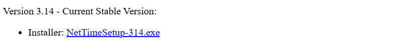

Penjelasan: NetTime digunakan untuk membantu menyinkronkan waktu komputer dengan server waktu melalui protokol NTP. Pengunduhan dilakukan melalui situs yang dirujuk dalam modul.

##### Langkah 2 — Mengunduh dan memasang NetTime

Unduh installer NetTime, kemudian buka file installer yang telah diunduh. Ikuti petunjuk instalasi yang muncul sampai proses pemasangan selesai.

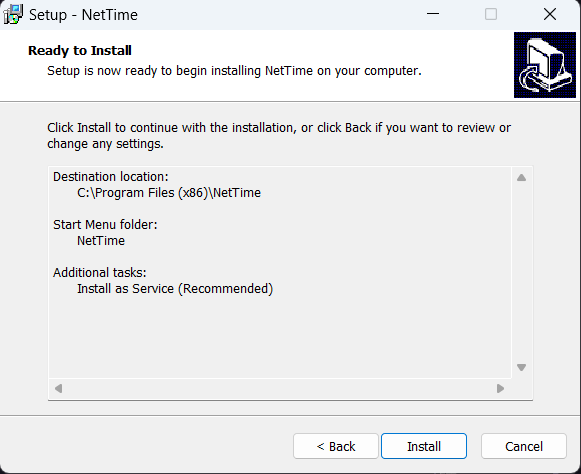

Penjelasan: Instalasi diperlukan agar aplikasi NetTime dapat dijalankan pada Windows. Jika muncul permintaan izin administrator, periksa sumber installer sebelum memberikan izin.

##### Langkah 3 — Membuka aplikasi NetTime

Setelah instalasi selesai, jalankan aplikasi NetTime. Perhatikan tampilan aplikasi, informasi waktu, serta pengaturan server waktu yang tersedia.

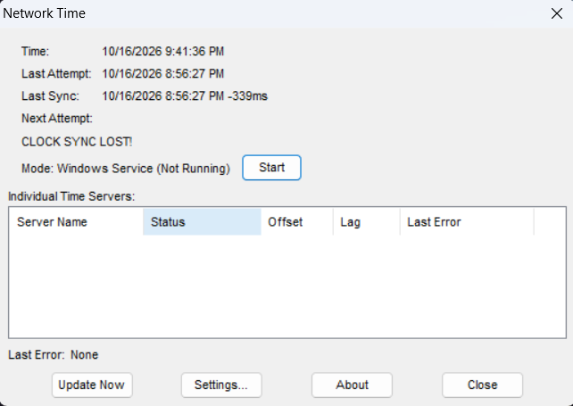

Penjelasan: Pada tahap ini, aplikasi dipersiapkan untuk melakukan sinkronisasi. Nama server dan status yang digunakan harus dicatat berdasarkan informasi yang benar-benar tampil pada aplikasi.

##### Langkah 4 — Melakukan sinkronisasi waktu

Gunakan fitur sinkronisasi yang tersedia pada NetTime. Apabila aplikasi menyediakan pengaturan server NTP, gunakan server yang tersedia atau yang diarahkan oleh pengaturan aplikasi. Tunggu sampai proses sinkronisasi selesai dan amati status yang ditampilkan.

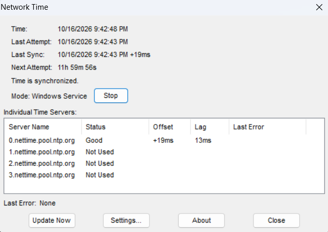

Penjelasan: NetTime berkomunikasi dengan server waktu untuk memperoleh informasi waktu acuan dan membantu menyesuaikan jam komputer. Hasil sinkronisasi bergantung pada koneksi jaringan, server yang digunakan, serta status aplikasi.

Hasil pengamatan:

Sinkronisasi waktu dilakukan menggunakan aplikasi NetTime pada Windows. Aplikasi digunakan untuk menyelaraskan waktu komputer dengan server waktu melalui NTP. Server yang digunakan dan status sinkronisasi dicatat berdasarkan tampilan aktual aplikasi.

#### 4.2 Praktikum Vector Clock

##### A. Menjalankan source code vclocks.py

###### Langkah 1 — Menyiapkan folder praktikum

Ekstrak file source code dari dosen ke folder yang mudah ditemukan, misalnya Praktikum-Modul-03. Pastikan file vclocks.py berada di dalam folder tersebut.

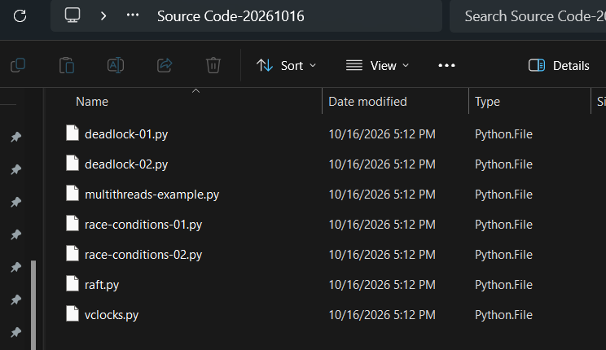

Penjelasan: Seluruh source code sebaiknya diletakkan dalam satu folder agar mudah dijalankan melalui terminal dan dikelola dalam repository GitHub.

###### Langkah 2 — Membuka terminal pada folder praktikum

Buka folder praktikum melalui File Explorer. Klik bagian alamat folder, ketik cmd, kemudian tekan Enter. Command Prompt akan terbuka pada lokasi folder tersebut.

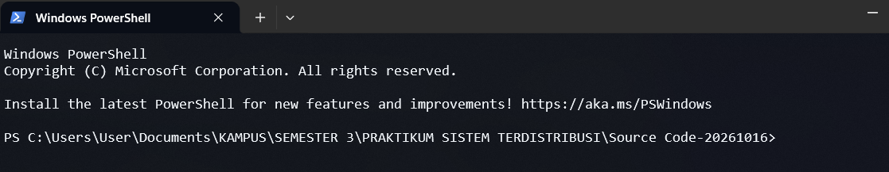

Penjelasan: Membuka CMD dari folder source memudahkan eksekusi program tanpa perlu mengetik alamat folder secara lengkap.

###### Langkah 3 — Memastikan Python tersedia

Pada CMD, jalankan perintah berikut:

```bash
python --version
```

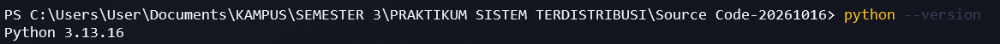

Penjelasan: Perintah ini digunakan untuk memeriksa apakah Python sudah terpasang dan dapat dipanggil melalui terminal. Gunakan perintah yang berhasil pada komputer masing-masing.

###### Langkah 4 — Menjalankan program Vector Clock

Jalankan perintah berikut:

```bash
python vclocks.py
```

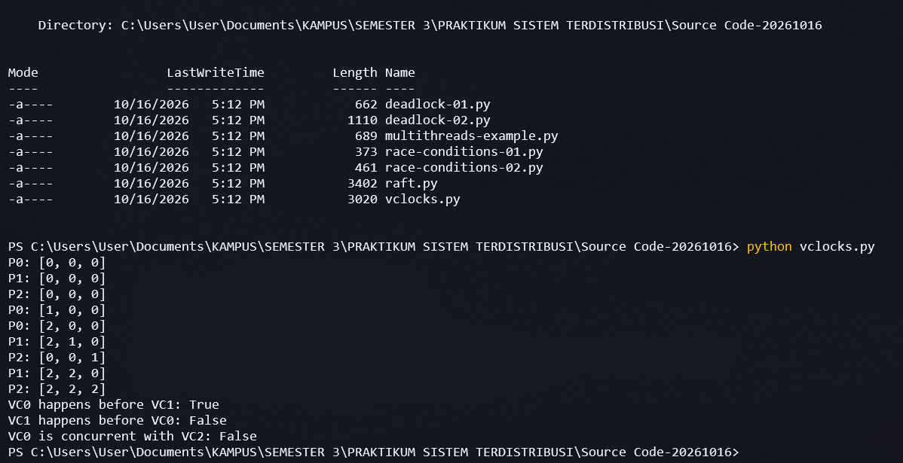

Penjelasan: Program menjalankan simulasi Vector Clock dan menampilkan informasi vektor dari beberapa proses. Saya amati nilai vektor dan hasil pemeriksaan hubungan kejadian yang dicetak oleh program.

###### Langkah 5 — Menganalisis keluaran program

Amati urutan kejadian yang dilakukan setiap proses. Pada source code, metode increment() menaikkan penghitung lokal, send_message() menaikkan penghitung sebelum mengirim vektor, dan receive_message() menggabungkan vektor yang diterima menggunakan nilai maksimum pada setiap komponen, kemudian menaikkan penghitung lokal.

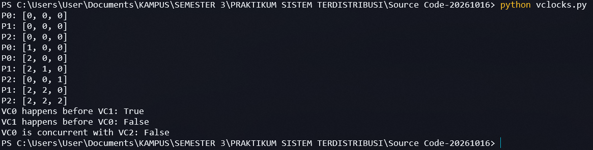

Penjelasan: Keluaran program dapat dibandingkan dengan perhitungan manual berdasarkan aturan Vector Clock. Perhitungan manual harus mengikuti urutan kejadian yang dilakukan pada source code, bukan urutan yang dibuat sendiri.

##### B. Membuat modul Python untuk Vector Clock

###### Langkah 6 — Membuat file modul

Buat file baru bernama vector_clock_module.py di folder praktikum. Salin implementasi class VectorClock dari source vclocks. Pastikan class dan metode yang diperlukan tetap dipertahankan, yaitu:

- increment()
- send_message()
- receive_message()
- happens_before()
- is_concurrent()

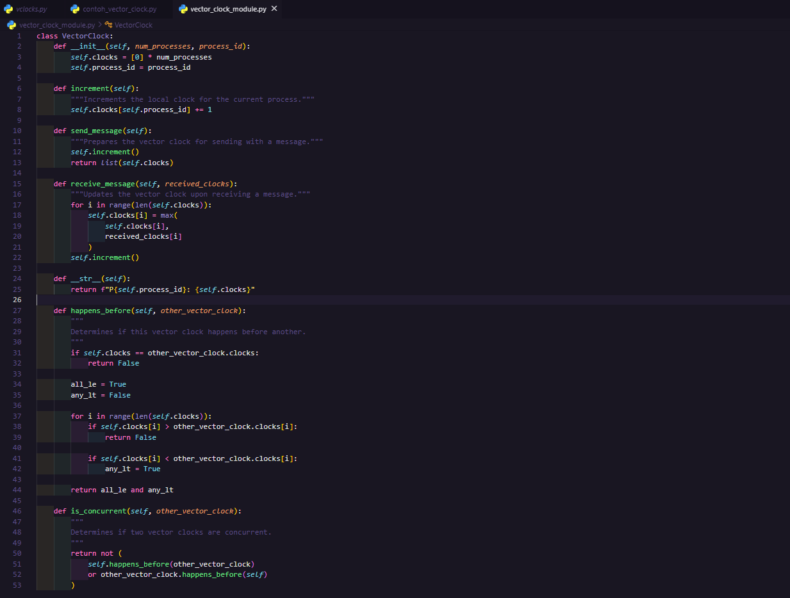

Penjelasan: Tugas modul meminta class VectorClock dibuat sebagai modul Python yang dapat digunakan oleh file lain. Memisahkan class ke file tersendiri membuat kode lebih mudah digunakan kembali.

###### Langkah 7 — Membuat program contoh penggunaan modul

Buat file baru bernama contoh_vector_clock.py, kemudian tulis kode berikut:

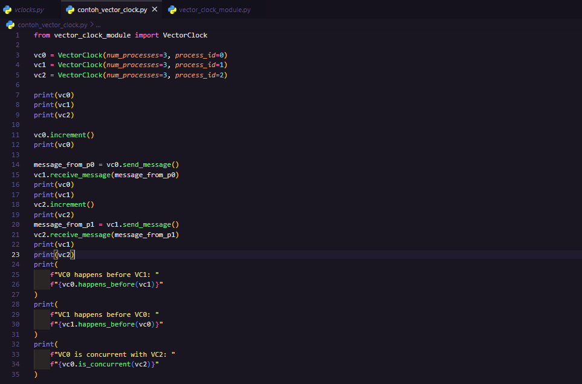

Penjelasan: Program contoh mengimpor class dari file modul, membuat dua objek Vector Clock, menjalankan event lokal pada P0, mengirim vektor, lalu menerima pesan pada P1. Contoh ini mengasumsikan constructor VectorClock pada source menerima jumlah proses sebagai argumen dan metode receive_message() menerima vektor serta indeks proses penerima.

###### Langkah 8 — Menjalankan program contoh

Pastikan file vector_clock_module.py dan contoh_vector_clock.py berada di folder yang sama. Jalankan:

```bash
python contoh_vector_clock.py
```

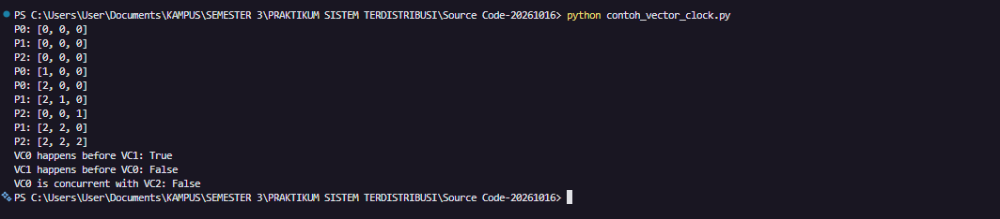

Penjelasan: Program menguji apakah class Vector Clock dapat diimpor dan digunakan melalui modul yang telah dibuat. Periksa nilai vektor yang ditampilkan dan bandingkan dengan aturan pembaruan Vector Clock.

#### 4.3 Problem Tanpa Sinkronisasi — Multithreading

##### Langkah 1 — Memeriksa source code

Buka file multithreading yang. Pada paket source yang digunakan, nama file tercatat sebagai multithreads-example.py.

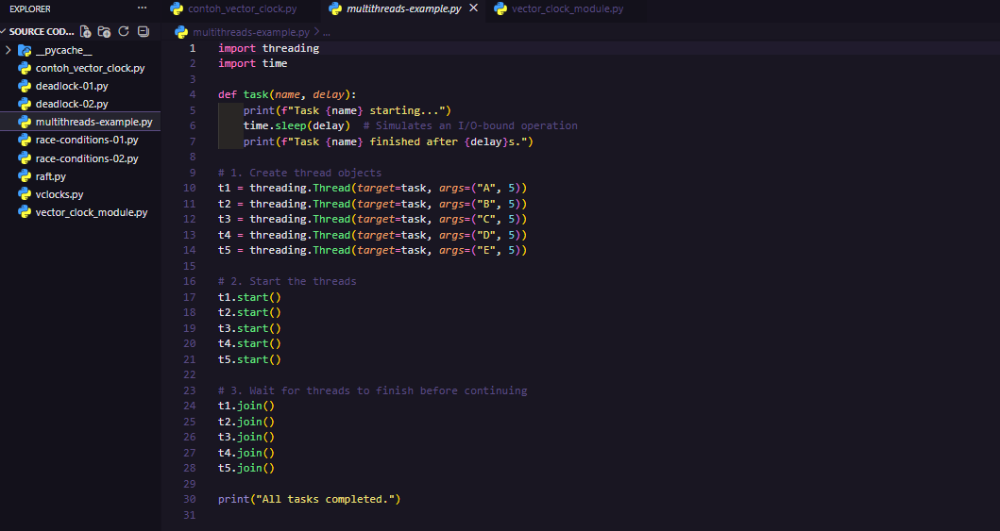

Penjelasan: Program ini membuat lima thread, yaitu A, B, C, D, dan E. Setiap thread menampilkan pesan mulai, menunggu selama lima detik, lalu menampilkan pesan selesai.

##### Langkah 2 — Menjalankan program

Jalankan program menggunakan nama file yang benar. Jika file bernama multithreads-example.py, gunakan:

```bash
python multithreads-example.py
```

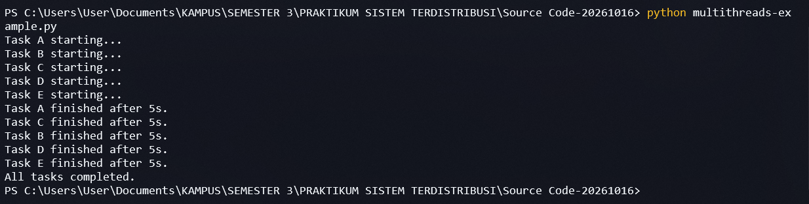

Penjelasan: Program menjalankan beberapa thread secara bersamaan. Perhatikan urutan pesan mulai dan selesai yang ditampilkan di CMD.

##### Langkah 3 — Menjalankan program kembali

Jalankan perintah yang sama untuk kedua kalinya:

```bash
python multithreads-example.py
```

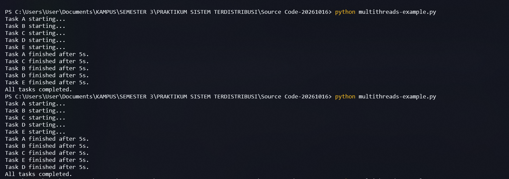

Penjelasan: Penjadwalan thread dapat menyebabkan urutan pesan berbeda antarpercobaan. Namun, karena setiap thread menggunakan jeda yang sama, hasilnya juga mungkin terlihat mirip.

##### Langkah 4 — Membandingkan hasil keluaran

Bandingkan kedua screenshot dan catat bagian yang urutannya berbeda, urutan pesan mulai atau selesai dari masing-masing thread.

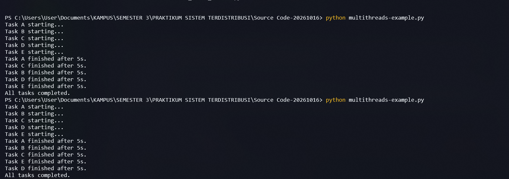

Penjelasan: Perbedaan urutan keluaran menunjukkan bahwa thread tidak selalu menyelesaikan pekerjaannya secara berurutan sesuai urutan pemanggilan. Waktu penjadwalan dan operasi yang dilakukan thread memengaruhi urutan pesan yang muncul.

Hasil pengamatan:

Program multithreading menjalankan lima thread yang masing-masing mencetak pesan mulai, menunggu lima detik, kemudian mencetak pesan selesai. Urutan keluaran perlu diamati melalui beberapa kali eksekusi. Jika terdapat perbedaan urutan, hal tersebut menunjukkan bahwa eksekusi thread dipengaruhi oleh penjadwalan sistem dan tidak sepenuhnya mengikuti urutan yang tetap.

#### 4.4 Data Race / Race Condition

##### A. Menjalankan race-conditions-01.py

###### Langkah 1 — Membuka source code

Buka file race-conditions-01.py pada editor kode. Perhatikan bagian variabel saldo, fungsi penarikan, pemeriksaan saldo, jeda sleep, dan pengurangan saldo.

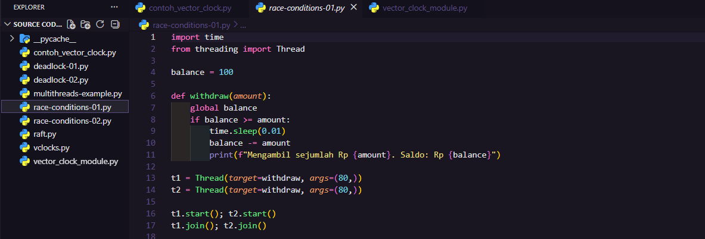

Penjelasan: Program menggunakan saldo awal sebesar 100 dan menjalankan dua thread yang masing-masing mencoba menarik 80. Pemeriksaan saldo dan pengurangan saldo tidak dilindungi oleh lock.

###### Langkah 2 — Menjalankan program

Pada CMD yang berada di folder source code, jalankan:

```bash
python race-conditions-01.py
```

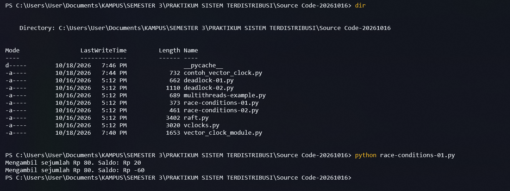

Penjelasan: Kedua thread mencoba melakukan penarikan pada data saldo yang sama. Karena terdapat jeda setelah pemeriksaan saldo, thread lain dapat berjalan sebelum saldo benar-benar dikurangi.

###### Langkah 3 — Mengamati hasil program

Perhatikan pesan penarikan yang berhasil atau gagal serta saldo akhir yang ditampilkan. Catat hasil yang benar-benar muncul di komputer.

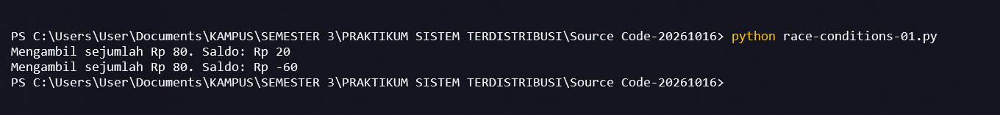

Penjelasan: Kedua thread dapat membaca saldo awal sebelum salah satunya mengurangi saldo. Akibatnya, keduanya mungkin sama-sama menganggap saldo mencukupi. Jika kedua pengurangan dilakukan, saldo dapat menjadi negatif. Hasil aktual bergantung pada urutan eksekusi thread.

##### B. Visualisasi manual race condition

###### Langkah 4 — Menggambar alur race condition

Buat gambar secara manual menggunakan pensil atau bolpoin sesuai instruksi modul, lalu foto hasilnya. Gambar dua thread yang memeriksa saldo bersama.

Contoh alur yang dapat dijadikan acuan:

1. Saldo awal = 100.
2. Thread 1 membaca saldo 100 dan memeriksa apakah saldo cukup untuk menarik 80.
3. Thread 2 juga membaca saldo 100 sebelum Thread 1 mengurangi saldo.
4. Thread 1 mengurangi saldo menjadi 20.
5. Thread 2 melanjutkan pengurangan berdasarkan hasil pemeriksaan sebelumnya sehingga saldo berpotensi menjadi -60.

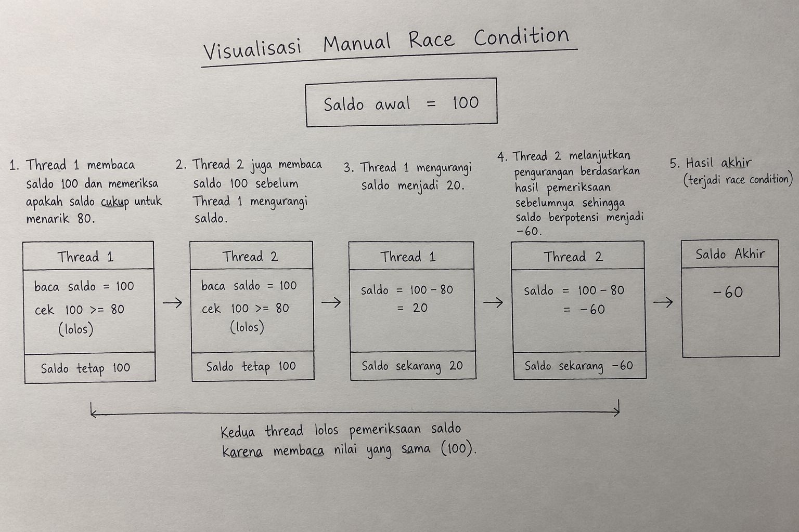

Penjelasan: Visualisasi menunjukkan bahwa kedua thread dapat lolos pemeriksaan saldo berdasarkan nilai yang sama. Karena pemeriksaan dan pengurangan tidak dilakukan sebagai satu bagian kritis yang terlindungi, data dapat berubah menjadi keadaan yang tidak sesuai harapan.

##### C. Menjalankan race-conditions-02.py

###### Langkah 5 — Memeriksa source code dengan lock

Buka file race-conditions-02.py. Perhatikan penggunaan threading.Lock() dan bagian kode yang dilindungi oleh lock tersebut.

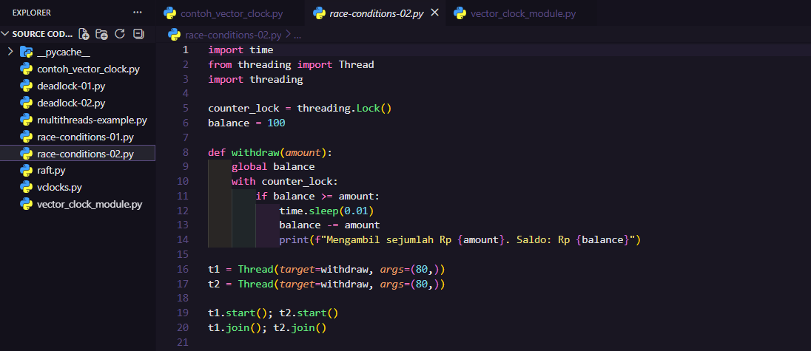

Penjelasan: Source ini menggunakan lock untuk melindungi pemeriksaan saldo dan proses pengurangan. Dengan demikian, hanya satu thread yang dapat menjalankan bagian kritis tersebut pada satu waktu.

###### Langkah 6 — Menjalankan program

Jalankan perintah berikut:

```bash
python race-conditions-02.py
```

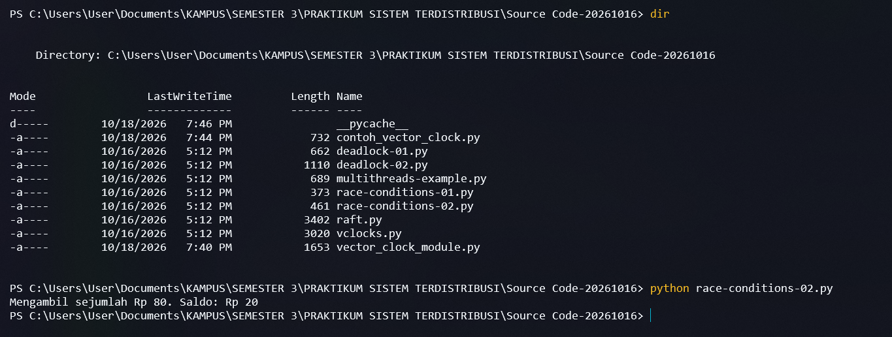

Penjelasan: Program menjalankan dua thread yang mencoba menarik 80 dari saldo awal 100, tetapi akses ke bagian kritis dilindungi oleh lock.

###### Langkah 7 — Membandingkan kedua program

Bandingkan hasil dari race-conditions-01.py dengan race-conditions-02.py. Perhatikan apakah penarikan kedua berhasil atau ditolak, serta berapa saldo akhirnya.

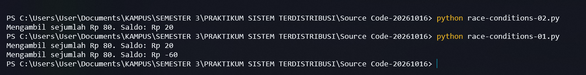

Penjelasan: Dengan lock, satu thread menyelesaikan pemeriksaan dan pengurangan saldo sebelum thread lainnya dapat memasuki bagian kritis. Setelah saldo berkurang menjadi 20, thread berikutnya akan memeriksa saldo yang sudah diperbarui dan seharusnya gagal menarik 80. Karena itu, saldo akhir adalah 20.

Hasil pengamatan:

Pada program pertama, dua thread mengakses saldo bersama tanpa mekanisme penguncian sehingga dapat terjadi race condition. Pada program kedua, threading.Lock() melindungi bagian pemeriksaan dan pengurangan saldo agar tidak dijalankan secara bersamaan. Bandingkan saldo akhir dan pesan penarikan dari kedua program berdasarkan hasil eksekusi yang diperoleh.

#### 4.5 Deadlock

##### A. Menjalankan deadlock-01.py

###### Langkah 1 — Memeriksa source code

Buka file deadlock-01.py. Perhatikan dua lock yang digunakan dan urutan pengambilannya oleh Thread 1 serta Thread 2.

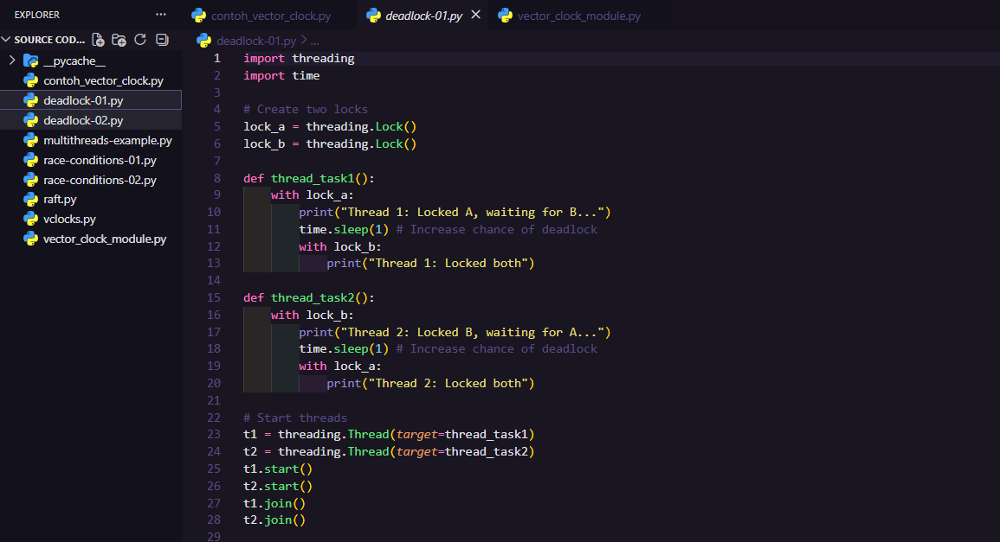

Penjelasan: Thread 1 mengambil Lock A kemudian menunggu Lock B. Sementara itu, Thread 2 mengambil Lock B kemudian menunggu Lock A. Susunan ini dapat menyebabkan kedua thread saling menunggu.

###### Langkah 2 — Menjalankan program

Jalankan:

```bash
python deadlock-01.py
```

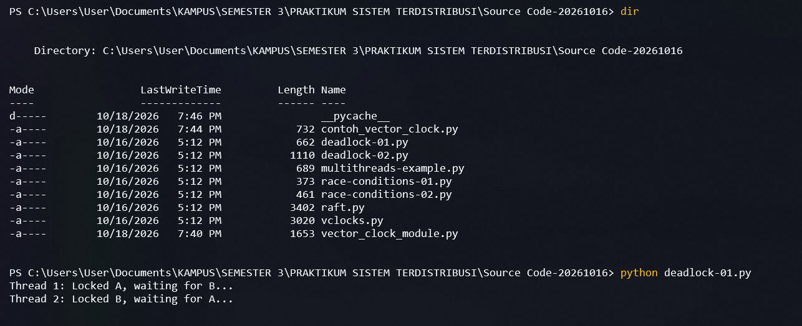

Penjelasan: Amati pesan yang ditampilkan sebelum program berhenti membuat kemajuan. Jika kedua thread masing-masing telah memegang satu lock dan menunggu lock lainnya, program dapat mengalami deadlock.

##### B. Visualisasi manual deadlock

###### Langkah 3 — Menggambar hubungan tunggu antar-thread

Buat gambar manual yang memperlihatkan dua thread dan dua lock. Gambarkan hubungan berikut:

- Thread 1 memegang Lock A dan menunggu Lock B.
- Thread 2 memegang Lock B dan menunggu Lock A.
- Buat panah dari Thread 1 menuju Lock B dan dari Thread 2 menuju Lock A untuk memperlihatkan kondisi saling menunggu.

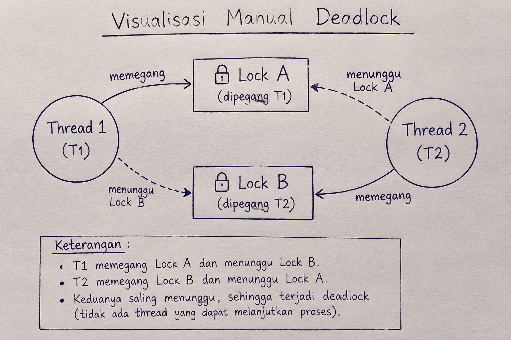

Penjelasan: Deadlock terjadi karena masing-masing thread menunggu lock yang masih dipegang thread lainnya. Tidak ada thread yang dapat melanjutkan ke tahap berikutnya jika kedua lock tidak dilepaskan.

##### C. Menjalankan deadlock-02.py

###### Langkah 4 — Memeriksa source code

Buka file deadlock-02.py. Amati bagaimana thread memperoleh lock, melepaskannya, kemudian mencoba mengambil lock berikutnya dengan menggunakan timeout.

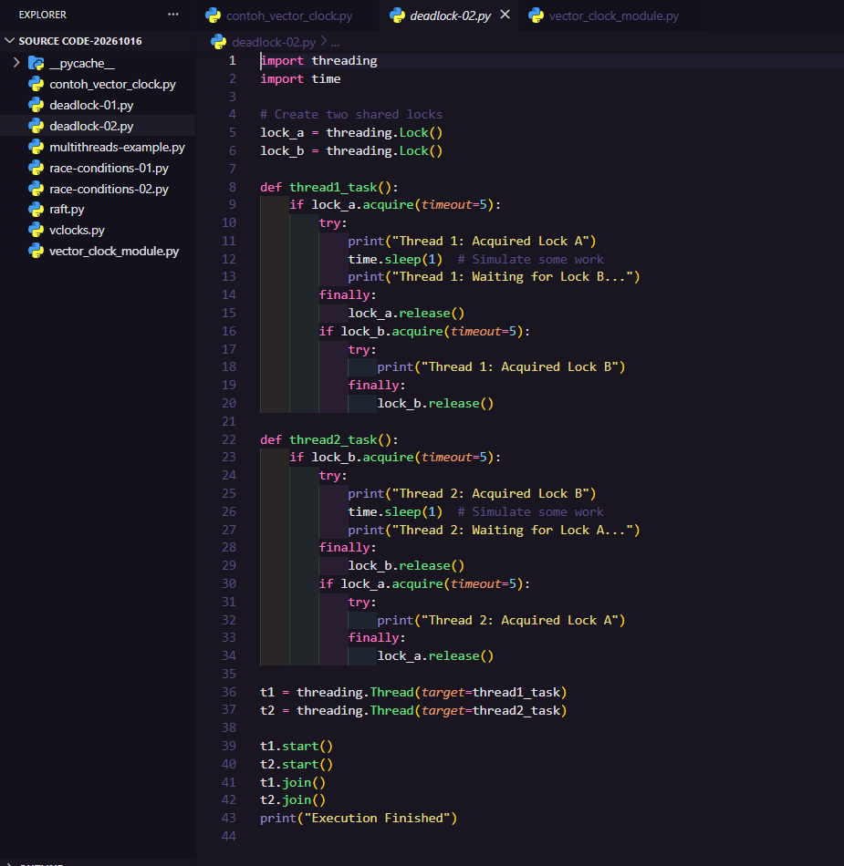

Penjelasan: Berbeda dari contoh pertama, source ini dirancang agar thread tidak terus memegang lock pertama ketika menunggu lock kedua. Penggunaan timeout juga membatasi waktu menunggu lock berikutnya.

###### Langkah 5 — Menjalankan program

Jalankan:

```bash
python deadlock-02.py
```

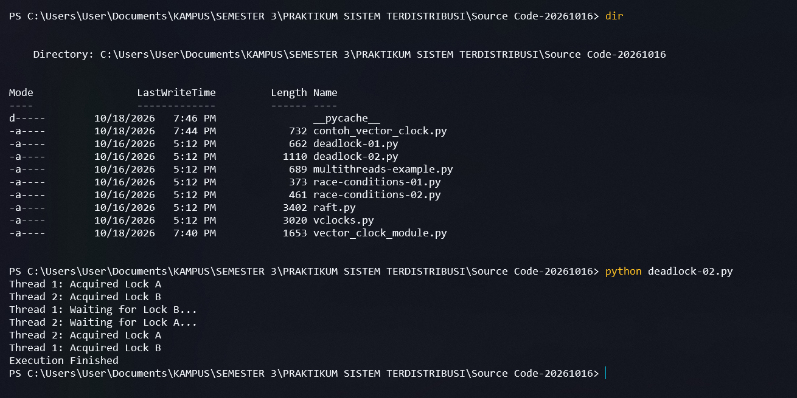

Penjelasan: Amati keluaran program sampai thread menyelesaikan tugasnya atau menampilkan pesan timeout. Pada contoh ini, mekanisme pelepasan lock dan timeout dirancang untuk menghindari deadlock seperti pada program pertama.

###### Langkah 6 — Membandingkan kedua program

Bandingkan perilaku deadlock-01.py dan deadlock-02.py. Catat apakah program tertahan, selesai, atau menampilkan pesan timeout.

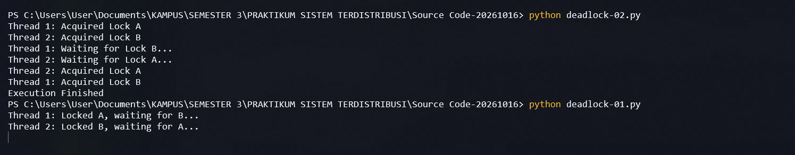

Penjelasan: Program pertama dapat mengalami siklus saling menunggu karena setiap thread mempertahankan lock yang dibutuhkan thread lain. Program kedua melepaskan lock sebelum mencoba mengambil lock berikutnya dan menggunakan timeout, sehingga pola deadlock pada contoh pertama dihindari.

Hasil pengamatan:

Program deadlock-01.py menunjukkan bagaimana urutan pengambilan lock yang berbeda dapat menyebabkan dua thread saling menunggu. Program deadlock-02.py menggunakan pendekatan pelepasan lock dan timeout untuk menghindari kondisi tersebut. Kesimpulan akhir perlu disesuaikan dengan keluaran yang benar-benar tampil pada terminal.

#### 4.6 Algoritma Raft

##### A. Menjalankan raft.py

###### Langkah 1 — Memeriksa source code

Buka file raft.py pada editor kode. Perhatikan class State, class RaftNode, metode start_election(), serta fungsi simulate_raft().

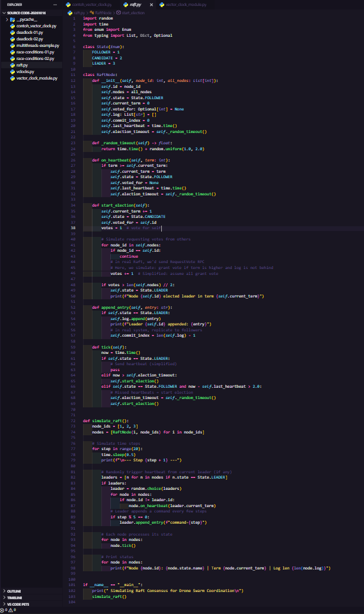

Penjelasan: Source code ini menyimulasikan tiga node. Setiap node memiliki status, term, informasi pemungutan suara, log, dan waktu heartbeat. Node dapat melakukan pemilihan ketika kondisi timeout pemilihan terpenuhi.

###### Langkah 2 — Menjalankan simulasi Raft

Jalankan perintah berikut:

```bash
python raft.py
```

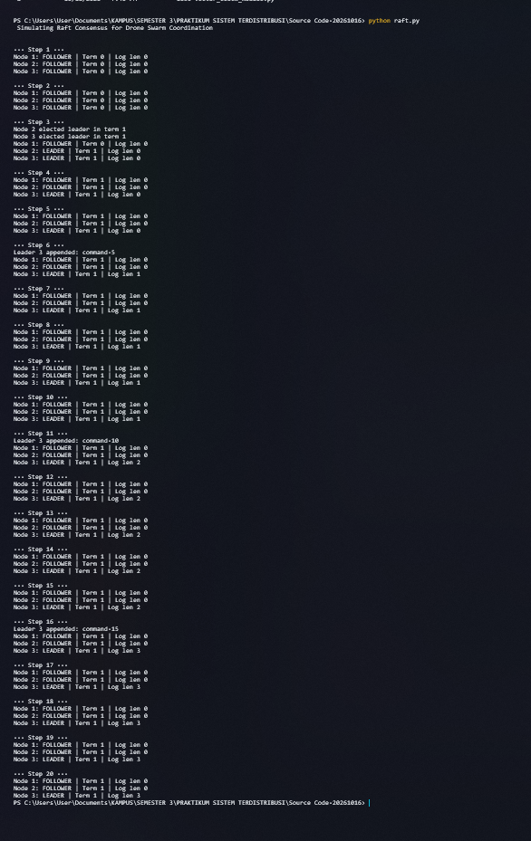

Penjelasan: Program menjalankan simulasi selama beberapa langkah. Perhatikan pesan terkait status node, pemilihan kandidat, pemberian suara, dan penetapan leader.

###### Langkah 3 — Mengamati pemilihan leader

Amati keluaran yang menunjukkan node menjadi kandidat dan memperoleh suara. Dalam source ini, pemilihan disederhanakan dengan asumsi bahwa node lain memberikan suara kepada kandidat. Kandidat menjadi leader jika jumlah suaranya lebih dari setengah jumlah node.

Penjelasan: Pada kelompok tiga node, mayoritas berarti minimal dua suara. Karena kandidat juga memberikan suara untuk dirinya sendiri, simulasi dapat menetapkan kandidat sebagai leader apabila jumlah suara memenuhi ketentuan mayoritas yang diterapkan pada kode.

###### Langkah 4 — Mengamati status node

Perhatikan status node yang muncul selama simulasi dan catat node yang menjadi leader jika ada. Jalankan program kembali jika diperlukan untuk melihat variasi hasil.

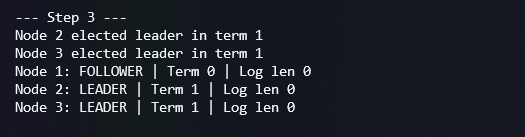

Penjelasan: Source menggunakan timeout pemilihan acak, sehingga urutan kejadian dan hasil keluaran dapat berbeda antar-eksekusi. Tuliskan hasil sesuai keluaran yang benar-benar muncul.

##### B. Visualisasi manual algoritma Raft

###### Langkah 5 — Menggambar proses pemilihan leader

Buat visualisasi manual menggunakan pensil atau bolpoin, kemudian foto hasilnya. Gambarkan tiga node dalam bentuk lingkaran dan beri label Node 1, Node 2, dan Node 3.

Contoh alur yang dapat digunakan sebagai panduan:

1. Salah satu node mengalami timeout pemilihan dan berubah menjadi kandidat.
2. Kandidat memulai pemilihan dan memberikan suara untuk dirinya sendiri.
3. Node lain memberikan suara sesuai simulasi pada source code.
4. Kandidat menghitung jumlah suara.
5. Jika jumlah suara melebihi setengah jumlah node, kandidat ditetapkan sebagai leader.

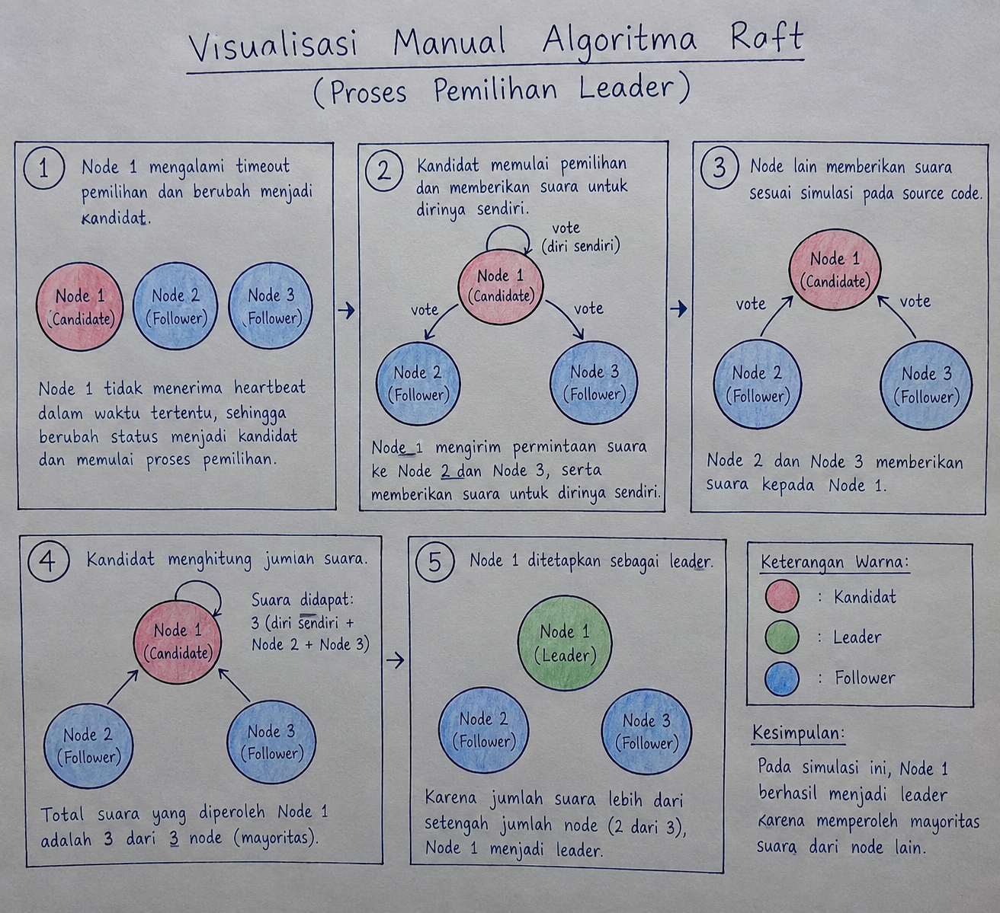

Penjelasan: Gambar harus menunjukkan proses pemilihan dan hubungan pemberian suara sampai kandidat memperoleh mayoritas. Sesuaikan node yang ditandai sebagai kandidat atau leader dengan hasil simulasi yang kamu amati.

##### C. Membuat modul Python untuk Raft

###### Langkah 6 — Membuat file modul

Buat file baru bernama raft_module.py. Salin bagian import yang diperlukan, class State, class RaftNode, dan fungsi simulasi yang dibutuhkan dari source raft.py ke dalam file tersebut.
Pastikan bagian yang diperlukan tetap tersedia, termasuk fungsi untuk memulai pemilihan dan menjalankan simulasi. Jangan mengubah logika source dosen tanpa alasan yang jelas.

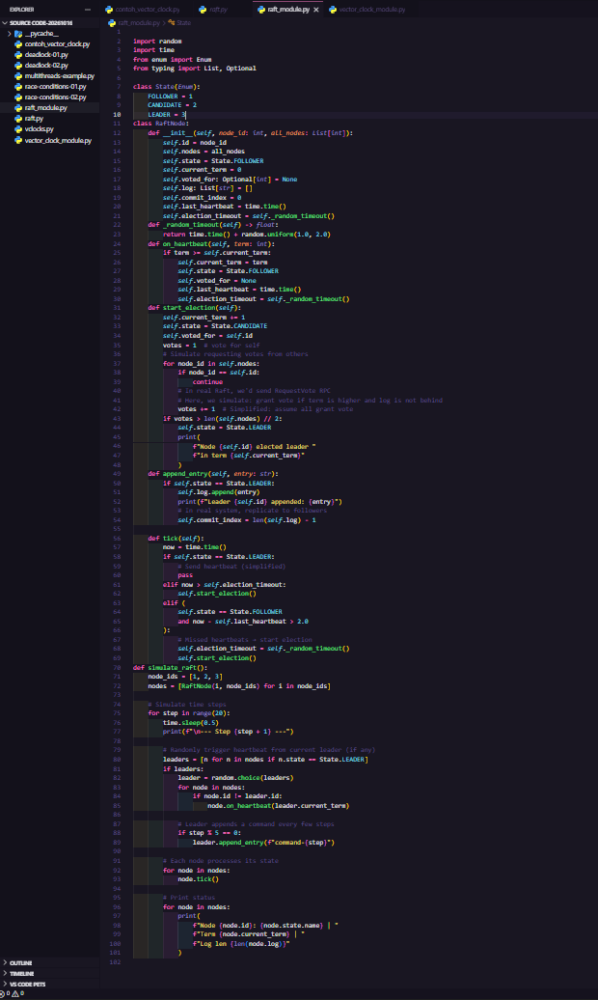

Penjelasan: Pemisahan class dan fungsi ke dalam modul membuat komponen Raft dapat digunakan kembali oleh program lain.

###### Langkah 7 — Membuat program contoh pemanggilan modul

Buat file baru bernama contoh_raft.py. Jika fungsi simulate_raft() sudah dipindahkan ke raft_module.py, contoh pemanggilan dapat ditulis seperti berikut:

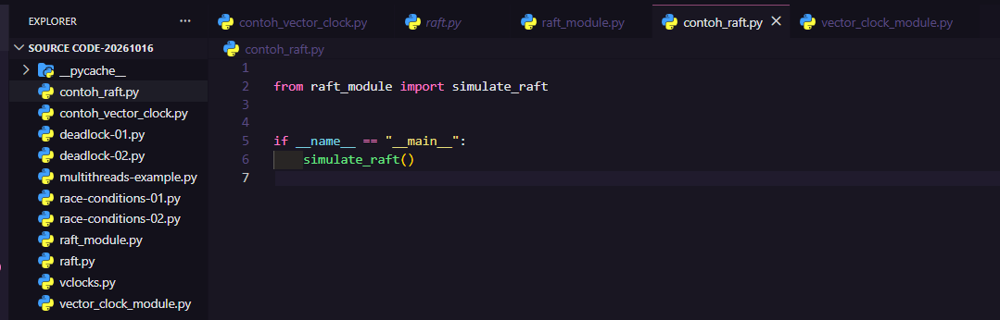

Penjelasan: File contoh mengimpor fungsi simulasi dari modul yang dibuat. Dengan demikian, program contoh tidak perlu mendefinisikan ulang seluruh class dan fungsi Raft.

###### Langkah 8 — Menjalankan contoh penggunaan modul

Pastikan raft_module.py dan contoh_raft.py berada di folder yang sama. Jalankan:

```bash
python contoh_raft.py
```

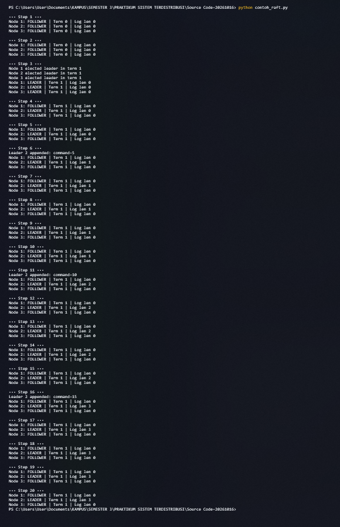

Penjelasan: Program menjalankan simulasi melalui fungsi yang diimpor dari modul. Amati keluaran dan bandingkan dengan hasil saat menjalankan raft.py secara langsung.

Hasil pengamatan:

Simulasi Raft memperlihatkan mekanisme dasar pemilihan leader melalui pemungutan suara. Kandidat menjadi leader jika memperoleh suara mayoritas sesuai logika pada source code. Karena simulasi menggunakan timeout acak dan aturan yang disederhanakan, hasil serta urutan keluaran dapat berbeda pada setiap eksekusi.

### 5. Kesimpulan

Praktikum Modul 3 memberikan pemahaman tentang pentingnya sinkronisasi dalam sistem terdistribusi. Sinkronisasi waktu membantu menyelaraskan jam komputer, Vector Clock digunakan untuk mencatat urutan logis kejadian, dan multithreading menunjukkan bahwa urutan eksekusi tidak selalu tetap. Race condition dapat dikurangi dengan melindungi akses data menggunakan lock, sedangkan deadlock dapat dihindari dengan mengatur penggunaan lock agar thread tidak saling menunggu. Simulasi Raft memperlihatkan konsep pemilihan leader berdasarkan suara mayoritas. Seluruh hasil akhir disesuaikan dengan eksekusi program dan screenshot yang diperoleh selama praktikum.