# Praktikum Minggu 04

# Bab 1. Tujuan Pembelajaran
Setelah menyelesaikan praktikum Modul 4, mahasiswa diharapkan mampu:
1. Memahami konsep konsistensi dan replikasi data dalam sistem terdistribusi.
2. Mengonfigurasi streaming replication PostgreSQL menggunakan Docker Compose.
3. Membedakan fungsi server primary dan replica serta menguji sinkronisasi data.
4. Memahami proses promosi replica menjadi primary ketika server utama mengalami gangguan.
5. Menjalankan cluster Apache Ignite yang terdiri dari beberapa node.
6. Menginisialisasi cluster, menjalankan query SQL, dan memeriksa replikasi data antarnode.

# Bab 2. Dasar Teori
## 2.1 Sistem Terdistribusi
Sistem terdistribusi adalah sistem yang terdiri dari beberapa komponen yang bekerja sama melalui komunikasi jaringan. Dalam sistem seperti ini, data dan layanan dapat ditempatkan pada beberapa server atau node untuk mendukung kebutuhan aplikasi.

## 2.2 Konsistensi dan Replikasi Data
Replikasi adalah proses menyalin atau menyinkronkan data dari satu server ke server lain. Tujuannya antara lain menjaga ketersediaan data, menyediakan salinan cadangan, dan mendukung pembacaan data dari beberapa node.

Konsistensi berkaitan dengan kesesuaian data yang terlihat pada berbagai node. Perilaku konsistensi aktual bergantung pada mekanisme replikasi dan waktu propagasi perubahan.

## 2.3 Streaming Replication PostgreSQL
Pada streaming replication, PostgreSQL menggunakan mekanisme Write-Ahead Logging (WAL) untuk mengirimkan perubahan dari server primary ke server standby atau replica. Primary menangani operasi penulisan, sedangkan replica mengikuti perubahan yang diterima dan umumnya menyediakan akses baca selama masih berstatus standby.

Modul menggunakan PostgreSQL 18.3 dalam container Docker. Replica dibuat dengan mengambil salinan awal data primary, kemudian mengikuti perubahan melalui mekanisme replikasi.

## 2.4 High Availability
High Availability (HA) adalah pendekatan untuk menjaga layanan tetap tersedia ketika terjadi gangguan. Salah satu cara yang dibahas dalam modul adalah mempromosikan replica menjadi primary ketika primary lama tidak tersedia.

Promosi ini bukan berarti failover otomatis sudah dikonfigurasi. Pada praktikum ini, promosi dilakukan secara manual sesuai instruksi modul. Primary lama harus ditangani dengan benar agar tidak kembali aktif sebagai primary bersamaan dengan node yang telah dipromosikan.

## 2.5 Replikasi Master-Master Apache Ignite
Pada bagian kedua, modul menggunakan Apache Ignite 3 untuk membentuk cluster yang terdiri dari tiga node. Berbeda dari model primary-replica pada PostgreSQL, materi ini membahas replikasi master-master, yaitu node-node dalam cluster menyediakan kemampuan operasi yang tidak terbatas pada satu primary saja.

Setelah cluster diinisialisasi, mahasiswa menjalankan perintah SQL dan memeriksa data melalui endpoint node yang berbeda untuk melihat apakah perubahan telah tersedia pada node lain.

## 2.6 Docker dan Docker Compose
Docker digunakan untuk menjalankan aplikasi di dalam container. Docker Compose mempermudah pengelolaan beberapa container melalui satu file konfigurasi YAML. Dalam praktikum ini, Docker digunakan untuk menjalankan server PostgreSQL maupun node Apache Ignite.

# Bab 3. Persiapan Praktikum di Windows
## 3.1 Langkah 1 — Siapkan Docker Desktop
1. Pastikan Docker Desktop telah terpasang.
2. Buka Docker Desktop dan tunggu sampai statusnya siap.
3. Buka PowerShell.
4. Jalankan perintah berikut:
docker --version
docker compose version

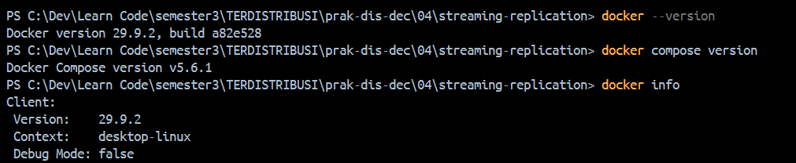

Penjelasan: perintah pertama memeriksa Docker CLI, perintah kedua memeriksa Docker Compose, dan perintah ketiga memastikan Docker Engine dapat diakses.

## 3.2 Langkah 2 — Siapkan folder praktikum
Contoh berikut menggunakan folder 04 di dalam repositori praktikum.
cd "C:\Dev\Learn Code\semester3\TERDISTRIBUSI\prak-dis-dec"

Buat dua folder untuk memisahkan kedua bagian praktikum:
mkdir streaming-replication
mkdir ignite-cluster

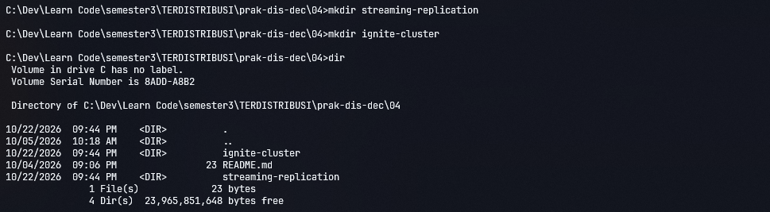

Penjelasan: pemisahan folder memudahkan pengelolaan konfigurasi PostgreSQL dan Apache Ignite serta mencegah file dari kedua praktikum tercampur.
README.md akan berisi laporan. File konfigurasi dan SQL disimpan dalam direktori masing-masing.

# Bab 4. Praktikum A — Streaming Replication PostgreSQL
## 4.1 Langkah 1 — Membuat file 00_init.sql
Masuk ke folder PostgreSQL:
cd streaming-replication
Buat file 00_init.sql dengan isi:

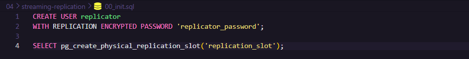

Penjelasan:
- CREATE USER membuat pengguna khusus untuk replikasi.
- WITH REPLICATION memberikan hak untuk melakukan replikasi PostgreSQL.
- pg_create_physical_replication_slot membuat replication slot yang digunakan untuk membantu menjaga WAL yang diperlukan replica.
File ini dipasang ke direktori inisialisasi PostgreSQL di dalam container. Script inisialisasi umumnya dijalankan saat direktori data database pertama kali dibuat, sehingga menjalankan ulang container yang sudah memiliki data tidak selalu menjalankan ulang script tersebut.

## 4.2 Langkah 2 — Membuat file docker-compose.yaml
Buat file bernama docker-compose.yaml dalam folder streaming-replication.

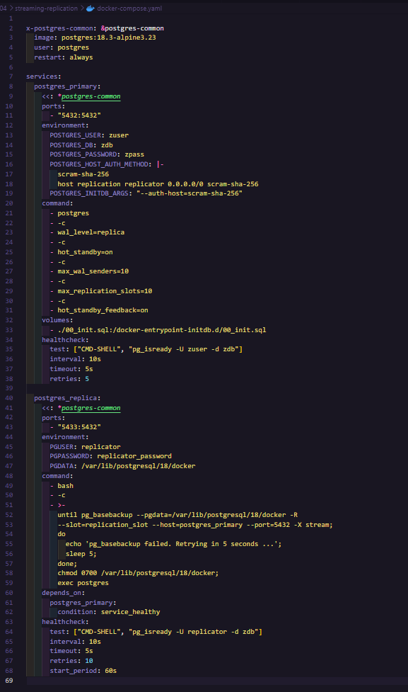

Penjelasan :
Komponen	Fungsi
postgres_primary	Server utama yang menerima perubahan data.
postgres_replica	Server standby yang menyalin data primary.
Port 5432:5432	Akses dari host ke PostgreSQL primary.
Port 5433:5432	Akses dari host ke PostgreSQL replica.
00_init.sql	Membuat pengguna dan replication slot pada inisialisasi.
wal_level=replica	Mengaktifkan level WAL yang diperlukan untuk replikasi.
pg_basebackup	Mengambil salinan awal data dari primary.
-R	Membantu menyiapkan konfigurasi standby pada data hasil backup.

## 4.3 Langkah 3 — Menjalankan kedua container
Pastikan PowerShell berada di folder streaming-replication, yaitu folder yang memuat docker-compose.yaml.
Jalankan:
docker compose up -d

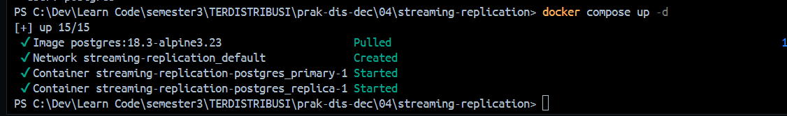

Penjelasan: Docker Compose membaca konfigurasi, mengambil image PostgreSQL apabila belum tersedia secara lokal, lalu membuat dan menjalankan service yang didefinisikan.
proses inisialisasi dan pengambilan data replica selesai.

## 4.4 Langkah 4 — Memeriksa status container
Jalankan:
docker compose ps

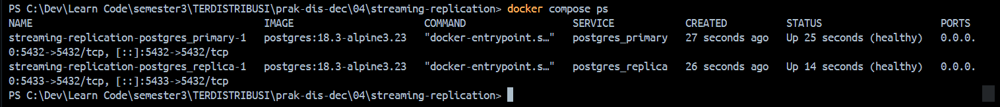

Perhatikan status kedua service. 
Untuk memeriksa log primary:
docker compose logs postgres_primary

Untuk memeriksa log replica:
docker compose logs postgres_replica
Penjelasan: log membantu mengetahui apakah database berhasil dimulai, apakah replica berhasil mengambil data dari primary, dan apakah terjadi kesalahan koneksi atau autentikasi.
Jika status belum sehat, jangan langsung melanjutkan pengujian. Periksa log untuk mencari penyebabnya.

## 4.5 Langkah 5 — Memeriksa status replikasi pada primary
Jalankan query melalui psql di dalam container primary:
docker compose exec postgres_primary psql -U zuser -d zdb
Setelah masuk ke prompt PostgreSQL, jalankan:

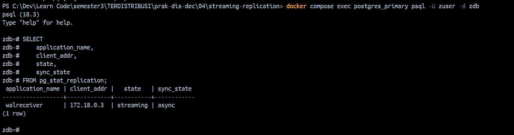

Penjelasan: pg_stat_replication menyediakan informasi mengenai koneksi standby yang terhubung ke primary. Jika replica berhasil terhubung, informasi koneksinya akan muncul pada hasil query.

## 4.6 Langkah 6 — Memeriksa apakah server merupakan replica
Masuk ke PostgreSQL replica:
docker compose exec postgres_replica psql -U replicator -d zdb

Jalankan:
SELECT pg_is_in_recovery();

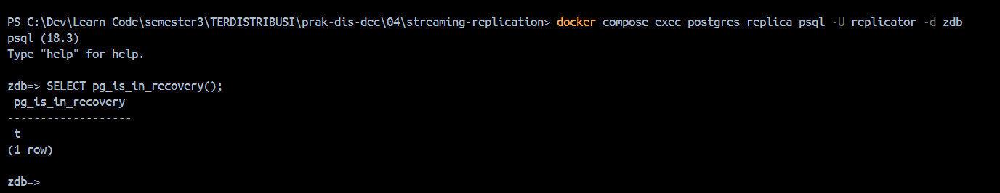

Penjelasan: hasil t atau true menunjukkan bahwa server masih berada dalam mode recovery/standby. Ini sesuai dengan perilaku replica yang dijelaskan pada halaman 7–8 modul.
Keluar dari psql dengan:
\q

Jika koneksi ditolak, periksa log dan konfigurasi autentikasi.

## 4.7 Langkah 7 — Menguji replikasi data
Masuk ke primary:
docker compose exec postgres_primary psql -U zuser -d zdb

Buat tabel pengujian dan masukkan data ini dan selanjutnya 
Periksa isi tabel:
SELECT * FROM praktikum_replikasi;

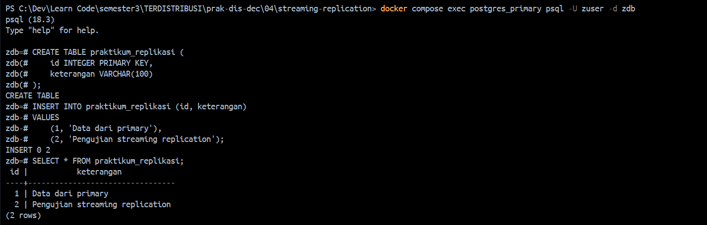

Penjelasan: tabel dan data dibuat pada primary. Dalam streaming replication yang berjalan normal, perubahan ini akan dikirim ke replica melalui mekanisme WAL.
Sekarang masuk ke replica:
docker compose exec postgres_replica psql -U replicator -d zdb
Jalankan query:

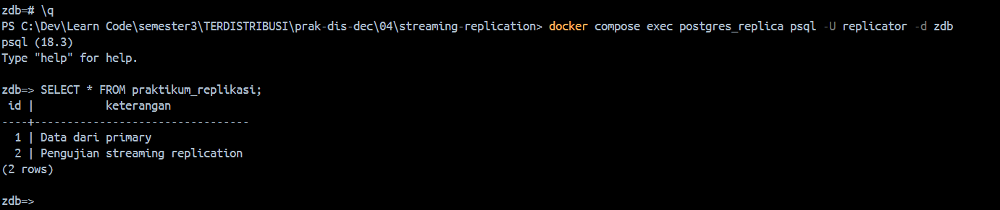

Hasil yang diharapkan: tabel dan baris yang dibuat pada primary terlihat pada replica setelah perubahan tersebut diterima.
Replica dalam mode standby tidak digunakan untuk operasi penulisan biasa. Jika hasil belum muncul, periksa status replikasi dan log kedua container.

## 4.8 Langkah 8 — Mempelajari High Availability
Selanjutnya menjelaskan promosi replica apabila primary mengalami gangguan.
Pertama, hentikan service primary dan Periksa status container:

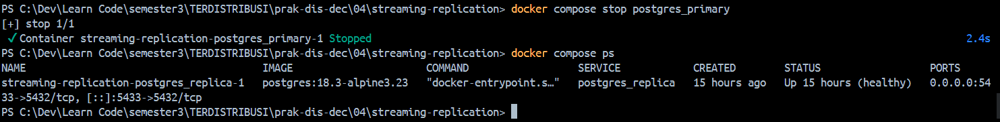

Setelah memastikan primary tidak aktif, masuk ke replica:
docker compose exec postgres_replica psql -U replicator -d zdb
Jalankan fungsi promosi yang dijelaskan pada modul:
SELECT pg_promote();

Periksa statusnya:
SELECT pg_is_in_recovery();

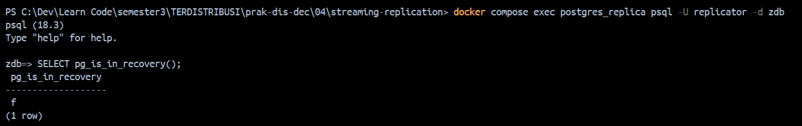

hasilnya f atau false, server tidak lagi berada dalam mode standby.
Penjelasan: pg_promote() meminta PostgreSQL mempromosikan standby menjadi primary yang dapat menerima penulisan. Promosi ini tidak otomatis mengalihkan aplikasi ke server baru dan tidak mengonfigurasi primary lama untuk bergabung kembali sebagai replica.

## 4.9 Langkah 9 — Mematikan lingkungan PostgreSQL
Jika pengujian telah selesai, jalankan:
docker compose down

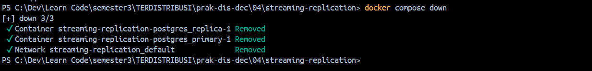

Perintah ini menghentikan dan menghapus container serta jaringan yang dibuat oleh Compose. Data yang tersimpan dalam volume persisten tidak otomatis dihapus, tetapi konfigurasi praktikum harus diperiksa sebelum lingkungan dibuat ulang.

# Bab 5. Praktikum B — Replikasi Master-Master Apache Ignite
Bagian ini mengikuti halaman 12–22 PDF. Modul meminta file docker-compose.yaml dan file SQL yang disediakan melalui dokumentasi resmi Apache Ignite. Gunakan file tersebut sebagai sumber konfigurasi, bukan membuat konfigurasi cluster sendiri tanpa dasar dari modul.

## 5.1 Langkah 1 — Mengunduh file konfigurasi Apache Ignite
Buka PowerShell dari folder praktikum utama, kemudian masuk ke direktori Ignite:
cd ..\ignite-cluster

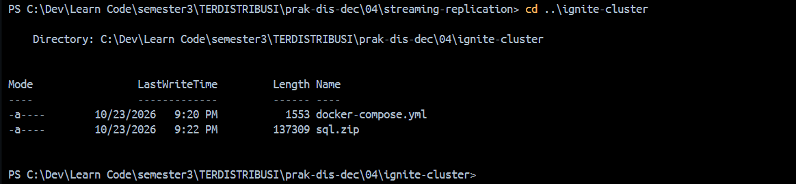

Unduh file konfigurasi dari tautan yang dicantumkan pada modul:

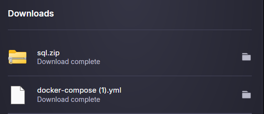

- docker-compose.yml resmi Apache Ignite
- Arsip file SQL
- Dokumentasi Quick Start dan SQL
Simpan file Compose sebagai docker-compose.yaml dan simpan arsip SQL sebagai sql.zip di folder ignite-cluster.
Penjelasan: file Compose mendefinisikan node-node Ignite yang akan dijalankan. Arsip SQL berisi skrip untuk membuat struktur dan mengisi data yang digunakan dalam pengujian.

## 5.2 Langkah 2 — Mengekstrak file SQL di Windows
Jalankan perintah berikut dari folder ignite-cluster:
Expand-Archive -Path .\sql.zip -DestinationPath . -Force
Periksa isi direktori:
Get-ChildItem
Get-ChildItem .\sql

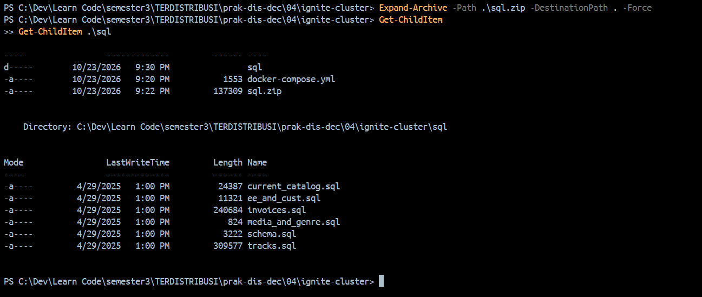

Penjelasan: file-file tersebut nantinya dipasang ke dalam container CLI agar perintah SQL dapat dibaca dan dijalankan dari lingkungan Ignite.

## 5.3 Langkah 3 — Menjalankan cluster Apache Ignite
Pastikan Docker Desktop aktif dan file docker-compose.yaml berada di direktori saat ini.
Jalankan:
docker compose up -d
Kemudian periksa container:
docker compose ps

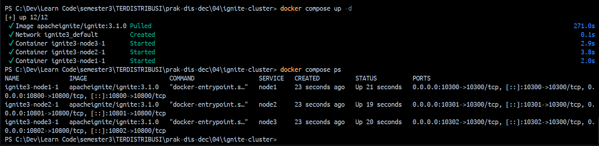

Penjelasan: perintah tersebut menjalankan layanan yang didefinisikan di file Compose. Modul menggunakan tiga node Ignite untuk membentuk cluster.

## 5.4 Langkah 4 — Memeriksa port node
cek port berikut:
Port host	Kegunaan menurut modul
10300	REST API node pertama
10301	REST API node kedua
10302	REST API node ketiga
10800–10802	Port koneksi aplikasi pada node-node Ignite

Periksa pemetaan port yang aktif:
docker compose ps

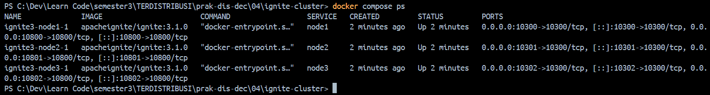

Penjelasan: pemetaan port memungkinkan layanan di dalam container diakses dari host. Untuk pengujian ini, endpoint administrasi yang dirujuk adalah http://localhost:10300, http://localhost:10301, dan http://localhost:10302.

## 5.5 Langkah 5 — Menginisialisasi cluster
membuka CLI menggunakan container image:
docker run --rm -it --network=host -e LANG=C.UTF-8 -e LC_ALL=C.UTF-8 apacheignite/ignite:3.0.0 cli

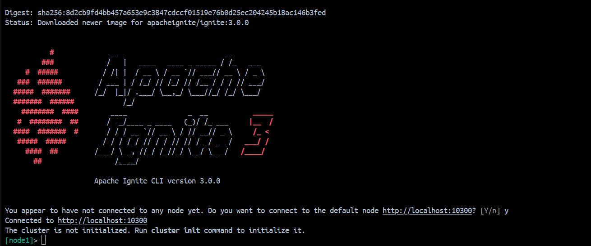

Penyesuaian Windows: opsi --network=host bergantung pada dukungan dan konfigurasi host networking Docker Desktop. Jika opsi tersebut tidak berfungsi, jangan terus mengulang perintah yang sama. Periksa konfigurasi jaringan Docker Desktop serta versi image dan Compose yang digunakan.

Setelah CLI terbuka dan terhubung ke endpoint node yang sesuai, jalankan:
cluster init --name=ignite3 --metastorage-group=node1,node2,node3

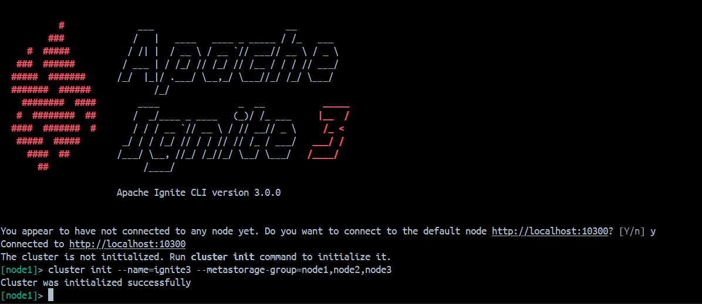

Penjelasan: perintah ini menginisialisasi cluster dengan nama ignite3 dan menetapkan node1, node2, serta node3 sebagai kelompok meta-storage sesuai instruksi modul.
Setelah inisialisasi selesai, keluar dari CLI dengan Ctrl+D sesuai petunjuk. Inisialisasi tidak perlu diulang jika cluster sudah berhasil diinisialisasi dan konfigurasinya tetap tersimpan.

## 5.6 Langkah 6 — Membuka CLI dengan akses ke file SQL
Modul menggunakan opsi volume -v untuk memasang folder SQL lokal ke lokasi /opt/ignite/sql di dalam container.
Contoh perintah yang menyesuaikan lokasi folder Windows:
docker run --rm -it --network=host -e LANG=C.UTF-8 -e LC_ALL=C.UTF-8 -v "${PWD}/sql:/opt/ignite/sql" apacheignite/ignite:3.1.0 cli

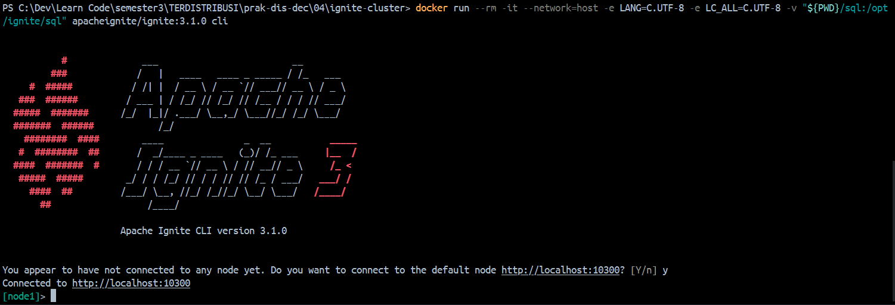

Perintah ini mengasumsikan bahwa folder sql ada di direktori aktif dan image 3.1.0 sesuai dengan konfigurasi cluster. Jika konfigurasi Compose memakai versi lain, samakan versi CLI dengan image yang benar-benar digunakan.
Penjelasan: parameter -v menghubungkan direktiri sql pada komputer Windows dengan /opt/ignite/sql di container. Dengan demikian, CLI dapat membaca file SQL tanpa perlu menyalinnya satu per satu ke dalam container.

## 5.7 Langkah 7 — Menjalankan perintah SQL
Setelah CLI terhubung ke node Ignite, ikuti urutan pada modul:
Selanjutnya, jalankan file SQL yang diperlukan berdasarkan petunjuk CLI dan dokumentasi yang digunakan. Nama file yang tersedia dalam paket SQL adalah schema.sql, current_catalog.sql, ee_and_cust.sql, invoices.sql, media_and_genre.sql, dan tracks.sql.

schema.sql :

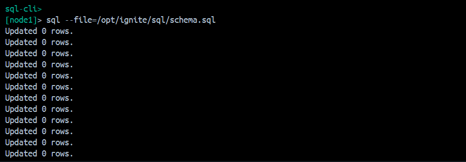

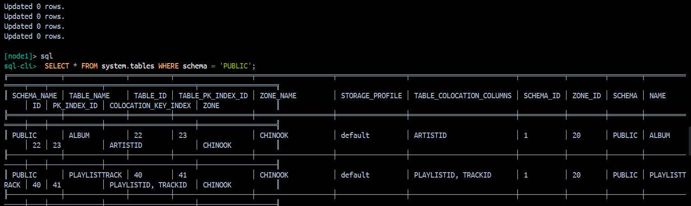

## 5.8 Langkah 8 — Memeriksa replikasi pada node lain
Pemeriksaan pada endpoint lain, terutama http://localhost:10301 dan http://localhost:10302.

Lakukan langkah berikut:
1. Hubungkan CLI ke node yang menggunakan endpoint http://localhost:10301.
2. Masuk ke mode SQL.
3. Periksa tabel dengan query berikut:
   SELECT * FROM system.tables WHERE schema = 'PUBLIC';
4. Bandingkan hasilnya dengan node 10300.
5. Ulangi pemeriksaan pada node 10302.
Penjelasan: tujuan pengujian ini adalah memeriksa apakah struktur dan data yang telah dibuat tersedia melalui node lain dalam cluster. Kesamaan hasil yang diamati menjadi bukti bahwa data telah tersedia pada node-node yang diuji.

Cara menentukan endpoint koneksi harus mengikuti versi Ignite CLI yang digunakan. Modul menjelaskan bahwa setiap node dapat diakses melalui port administrasi masing-masing; gunakan konfigurasi koneksi yang benar pada CLI.

## 5.9 Langkah 9 — Menjalankan query analitik
Pada halaman 20, modul memberikan contoh query untuk membuat ringkasan penjualan bulanan berdasarkan tabel Invoice.

Query tersebut menghitung jumlah invoice, jumlah pelanggan, total penjualan, serta rata-rata nilai transaksi per bulan. Jalankan query tersebut setelah tabel dan data terkait tersedia.

Jika query gagal, periksa terlebih dahulu:
- Apakah file SQL untuk tabel invoice sudah dijalankan.
- Apakah nama tabel dan kolom sesuai dengan schema yang terbentuk.
- Apakah CLI terhubung ke node dan cluster yang benar.
Penjelasan: langkah ini memperlihatkan penggunaan data yang telah disiapkan dalam cluster untuk menjalankan query analitik, bukan hanya memeriksa keberadaan tabel.

Jangan mencatat hasil angka penjualan tertentu sebelum query benar-benar dijalankan dan hasilnya diamati.

## 5.10 Langkah 10 — Mematikan cluster Apache Ignite
Setelah pengujian selesai, kembali ke PowerShell pada direktori yang berisi file Compose Ignite.

Jalankan:
docker compose down

Kemudian periksa apakah container telah berhenti:
docker ps

Penjelasan: docker compose down menghentikan dan menghapus container serta jaringan yang dibuat oleh Compose. Data persisten dapat tetap tersimpan apabila menggunakan volume. Jangan menghapus volume secara sembarangan jika data pengujian masih diperlukan.

# Bab 6. Kesimpulan
Praktikum Modul 4 membahas dua pendekatan replikasi dalam sistem terdistribusi. Pada PostgreSQL, streaming replication digunakan untuk menyinkronkan perubahan data dari primary ke replica. Pengujian juga memperkenalkan konsep High Availability melalui promosi replica menjadi primary ketika server utama mengalami gangguan. Pada Apache Ignite, cluster tiga node digunakan untuk mempelajari replikasi master-master. Proses praktikum meliputi menjalankan node, menginisialisasi cluster, mengeksekusi perintah SQL, dan memeriksa data melalui node yang berbeda.

Melalui kedua praktikum tersebut, mahasiswa dapat mempelajari perbedaan arsitektur primary-replica dan master-master, penggunaan Docker untuk menjalankan layanan, serta pentingnya pengujian untuk memastikan bahwa mekanisme replikasi bekerja sebagaimana mestinya.
